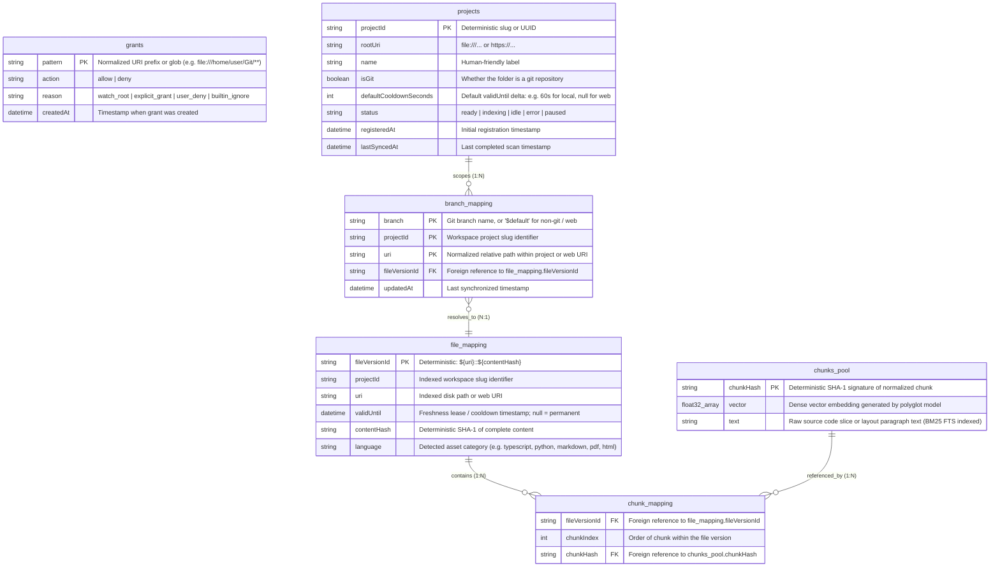

# LanceDB Storage Schema (6 Tables)

This document specifies the relational and vector storage model for `prag` inside LanceDB.

## Schema Overview

Storage is organized into six tables decoupling URI grant policies (allow/deny rules), discovered project boundaries, active branch pointers, immutable file versions, chunk sequences, and deduplicated vector content (Content-Addressable Storage):

## Table Specifications

### 1. `grants`
Represents the unified allow/deny URI policy rule set controlling directory discovery, Chokidar monitoring, and web scraping.

| Field Name | Data Type | Constraints / Attributes | Description |
|---|---|---|---|
| `pattern` | `String` | Primary Key | Normalized URI prefix or glob pattern (e.g. `file:///home/user/Git/**`, `https://docs.site.com/**`, `**/node_modules/**`). |
| `action` | `String` | Non-Null | `'allow'` or `'deny'`. |
| `reason` | `String` | Non-Null | Rule origin: `'watch_root'`, `'explicit_grant'`, `'user_deny'`, `'builtin_ignore'`. |
| `createdAt` | `DateTime` | Non-Null | Timestamp when grant was defined. |

#### Evaluation Semantics:
1. **Deny by default:** A URI is only watched/indexed if matched by an `allow` rule.
2. **Longest Prefix Match (Most Specific Rule Wins):** A specific `deny` pattern (e.g. `file:///home/user/Git/secret/**`) overrides a broader `allow` pattern (e.g. `file:///home/user/Git/**`).
3. **Deny breaks ties:** If allow and deny match at identical length/specificity, `deny` takes precedence.

### 2. `projects`
Tracks discovered atomic project boundaries, Git repositories, non-git directories, and remote web namespaces within the allowed URI space.

| Field Name | Data Type | Constraints / Attributes | Description |
|---|---|---|---|
| `projectId` | `String` | Primary Key, Indexed | Unique slug identifier (e.g. `prag`, `lance-docs`). |
| `rootUri` | `String` | Unique, Indexed | Root URI: `file:///path/to/repo` or `https://docs.site.com`. |
| `name` | `String` | Non-Null | Human-readable project label. |
| `isGit` | `Boolean` | Non-Null | `true` if directory contains `.git/`, `false` for plain folders or web. |
| `defaultCooldownSeconds` | `Integer` | Nullable | Freshness lease delta added to `validUntil` (e.g. 60s for local code, `null` for static web). |
| `status` | `String` | Non-Null | Ingestion state: `'ready' | 'indexing' | 'idle' | 'error' | 'paused'`. |
| `registeredAt` | `DateTime` | Non-Null | Initial registration timestamp. |
| `lastSyncedAt` | `DateTime` | Nullable | Timestamp of last full scan/reconciliation. |

### 3. `branch_mapping`
Represents the mutable working state pointer of active branches and non-git workspaces to immutable file versions.

| Field Name | Data Type | Constraints / Attributes | Description |
|---|---|---|---|
| `branch` | `String` | Composite PK, Indexed | Git branch name (e.g. `main`, `feature-login`), or `$default` for non-Git local folders and remote web URIs. |
| `projectId` | `String` | Composite PK, Indexed | Foreign reference to `projects.projectId`. |
| `uri` | `String` | Composite PK, Indexed | Relative file path within workspace, or normalized web URI. |
| `fileVersionId` | `String` | Foreign Reference, Non-Null | Deterministic key pointing to active `file_mapping.fileVersionId`. |
| `updatedAt` | `DateTime` | Non-Null | Timestamp of last synchronization or modification. |

### 4. `file_mapping`
Maps immutable content hashes and file versions to structural metadata and validity leases.

| Field Name | Data Type | Constraints / Attributes | Description |
|---|---|---|---|
| `fileVersionId` | `String` | Primary Key, Deterministic | Format: `${uri}::${contentHash}` |
| `projectId` | `String` | Indexed | Foreign reference to `projects.projectId`. |
| `uri` | `String` | Indexed | Relative disk path or web URI. |
| `validUntil` | `DateTime` | Nullable | Freshness lease / cooldown timestamp. While `now() < validUntil`, reindexing triggers and web rescans are suppressed. `null` = permanent. |
| `contentHash` | `String` | Indexed, Fixed Length | Deterministic SHA-1 signature of complete indexed content. |
| `language` | `String` | None | Detected asset category (e.g. `typescript`, `python`, `markdown`, `pdf`, `html`). |

### 5. `chunk_mapping`
Many-to-many relationship mapping immutable file versions to ordered chunk sequences.

| Field Name | Data Type | Constraints / Attributes | Description |
|---|---|---|---|
| `fileVersionId` | `String` | Foreign Reference, Indexed | Points to matching signature within `file_mapping`. |
| `chunkIndex` | `Integer` | Order index | Order of chunks in the file version (0-indexed). An oversized AST node sub-chunked per ADR-014 occupies several consecutive indices. |
| `chunkHash` | `String` | Foreign Reference, Indexed | Points to matching signature within `chunks_pool`. |

### 6. `chunks_pool`
Represents the deduplicated global pool of vector embeddings and structural text slices.

| Field Name | Data Type | Constraints / Attributes | Description |
|---|---|---|---|
| `chunkHash` | `String` | Primary Key, Fixed Length | Deterministic SHA-1 signature of the chunk. |
| `vector` | `Float32 Array` | Model dimension (e.g. 384) | Dense embedding representation generated by the configured polyglot model. |
| `text` | `String` | Non-Null | Raw text code slice or layout paragraph block (indexed with BM25 FTS). |
