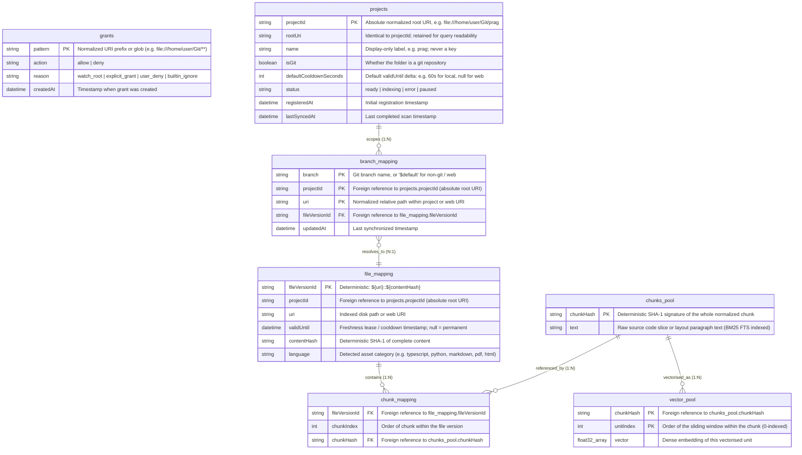

# LanceDB Storage Schema (7 Tables)

This document specifies the relational and vector storage model for `prag` inside LanceDB.

## Chunks vs Vectorised Units (ADR-014)

Two concepts are deliberately kept apart throughout this schema:

- A **chunk** is one complete structural unit — a Tree-sitter node, or a layout block for documents. It is the unit of retrieval, of ordering within a file version, and of content-addressable dedup. `chunkHash` covers the whole chunk regardless of size; a chunk is never split.
- A **vectorised unit** is a sliding token window over a single chunk, sized to fit the active embedding model. A chunk yields **1..\*** vectorised units — exactly one when it already fits under `embedding.maxVectorUnitTokens`.

So `chunks_pool` holds content (and is the BM25 target), while `vector_pool` holds one or more vectors per chunk.

## Schema Overview

Storage is organized into seven tables decoupling URI grant policies (allow/deny rules), discovered project boundaries, active branch pointers, immutable file versions, chunk sequences, deduplicated chunk content, and the vectors derived from it (Content-Addressable Storage):

## Table Specifications

### 1. `grants`
Represents the unified allow/deny URI policy rule set controlling directory discovery, Chokidar monitoring, and web scraping.

| Field Name | Data Type | Constraints / Attributes | Description |
|---|---|---|---|
| `pattern` | `String` | Primary Key | Normalized URI prefix or glob pattern (e.g. `file:///home/user/Git/**`, `https://docs.site.com/**`, `**/node_modules/**`). |
| `action` | `String` | Non-Null | `'allow'` or `'deny'`. |
| `reason` | `String` | Non-Null | Rule origin: `'watch_root'`, `'explicit_grant'`, `'user_deny'`, `'builtin_ignore'`. |
| `createdAt` | `DateTime` | Non-Null | Timestamp when grant was defined. |

#### Evaluation Semantics:
1. **Deny by default:** A URI is only watched/indexed if matched by an `allow` rule.
2. **Longest Prefix Match (Most Specific Rule Wins):** A specific `deny` pattern (e.g. `file:///home/user/Git/secret/**`) overrides a broader `allow` pattern (e.g. `file:///home/user/Git/**`).
3. **Deny breaks ties:** If allow and deny match at identical length/specificity, `deny` takes precedence.

### 2. `projects`
Tracks discovered atomic project boundaries, Git repositories, non-git directories, and remote web namespaces within the allowed URI space.

| Field Name | Data Type | Constraints / Attributes | Description |
|---|---|---|---|
| `projectId` | `String` | Primary Key, Indexed | **The project's absolute normalized root URI**: `file:///home/user/Git/prag` or `https://docs.site.com`. Not a derived slug -- a slug collides when two checkouts share a basename (`~/work/utils` and `~/personal/utils`), and this is a primary key. |
| `rootUri` | `String` | Unique, Indexed | Identical to `projectId`. Retained as a named column for query readability; the two are the same value by definition and must never diverge. |
| `name` | `String` | Non-Null | Human-readable project label (e.g. `prag`), derived from the root basename. **Display only** -- never a key, never used for lookup, free to collide across projects. CLI and MCP output show this, not the full URI. |
| `isGit` | `Boolean` | Non-Null | `true` if directory contains `.git/`, `false` for plain folders or web. |
| `defaultCooldownSeconds` | `Integer` | Nullable | Freshness lease delta added to `validUntil` (e.g. 60s for local code, `null` for static web). |
| `status` | `String` | Non-Null | Ingestion state. `'ready'`: fully indexed and up to date. `'indexing'`: a scan, rebuild, or queued batch is outstanding. `'error'`: last scan failed; see daemon logs. `'paused'`: a `deny` grant or explicit user action has suspended watching. |
| `registeredAt` | `DateTime` | Non-Null | Initial registration timestamp. |
| `lastSyncedAt` | `DateTime` | Nullable | Timestamp of last full scan/reconciliation. |

### 3. `branch_mapping`
Represents the mutable working state pointer of active branches and non-git workspaces to immutable file versions.

| Field Name | Data Type | Constraints / Attributes | Description |
|---|---|---|---|
| `branch` | `String` | Composite PK, Indexed | Git branch name (e.g. `main`, `feature-login`), or `$default` for non-Git local folders and remote web URIs. |
| `projectId` | `String` | Composite PK, Indexed | Foreign reference to `projects.projectId`. |
| `uri` | `String` | Composite PK, Indexed | File path **relative to the project root**, or the path portion of a web URI. The absolute URI of any indexed file is therefore `projectId + '/' + uri`, which is what `grants` patterns are matched against. |
| `fileVersionId` | `String` | Foreign Reference, Non-Null | Deterministic key pointing to active `file_mapping.fileVersionId`. |
| `updatedAt` | `DateTime` | Non-Null | Timestamp of last synchronization or modification. |

### 4. `file_mapping`
Maps immutable content hashes and file versions to structural metadata and validity leases.

| Field Name | Data Type | Constraints / Attributes | Description |
|---|---|---|---|
| `fileVersionId` | `String` | Primary Key, Deterministic | Format: `${uri}::${contentHash}` |
| `projectId` | `String` | Indexed | Foreign reference to `projects.projectId`. |
| `uri` | `String` | Indexed | File path relative to the project root, or the path portion of a web URI. Same convention as `branch_mapping.uri`: absolute URI is `projectId + '/' + uri`. |
| `validUntil` | `DateTime` | Nullable | Freshness lease / cooldown timestamp. While `now() < validUntil`, reindexing triggers and web rescans are suppressed. `null` = permanent. |
| `contentHash` | `String` | Indexed, Fixed Length | Deterministic SHA-1 signature of complete indexed content. |
| `language` | `String` | None | Detected asset category (e.g. `typescript`, `python`, `markdown`, `pdf`, `html`). |

### 5. `chunk_mapping`
Many-to-many relationship mapping immutable file versions to ordered chunk sequences.

| Field Name | Data Type | Constraints / Attributes | Description |
|---|---|---|---|
| `fileVersionId` | `String` | Foreign Reference, Indexed | Points to matching signature within `file_mapping`. |
| `chunkIndex` | `Integer` | Order index | Order of chunks in the file version (0-indexed). Exactly one row per structural unit, whatever its size — oversized units are windowed in `vector_pool`, not split here (ADR-014). |
| `chunkHash` | `String` | Foreign Reference, Indexed | Points to matching signature within `chunks_pool`. |

### 6. `chunks_pool`
Represents the deduplicated global pool of structural chunk content. This is the BM25 full-text search target and the unit returned by search.

| Field Name | Data Type | Constraints / Attributes | Description |
|---|---|---|---|
| `chunkHash` | `String` | Primary Key, Fixed Length | Deterministic SHA-1 signature of the whole whitespace-normalized chunk (ADR-010), independent of chunk size. |
| `text` | `String` | Non-Null | Raw text code slice or layout paragraph block, complete and unsplit (indexed with BM25 FTS). |

### 7. `vector_pool`
Holds the dense embeddings derived from each chunk. A chunk that fits the model has exactly one row here; an oversized chunk has one row per sliding window (ADR-014).

| Field Name | Data Type | Constraints / Attributes | Description |
|---|---|---|---|
| `chunkHash` | `String` | Composite PK, Foreign Reference, Indexed | Points to the owning row in `chunks_pool`. |
| `unitIndex` | `Integer` | Composite PK | Order of the vectorised unit within the chunk (0-indexed). `0` is the only value for chunks that fit. |
| `vector` | `Float32 Array` | Model dimension (e.g. 384) | Dense embedding of this unit's text, prefixed at embedding time with the chunk's enclosing scope annotation. The prefixed text is not stored. |

Dense search scores `vector_pool`, collapses to the best-scoring `unitIndex` per `chunkHash`, and from there ranks, fuses and returns **chunks** — so one large function surfaces once, not once per window.
